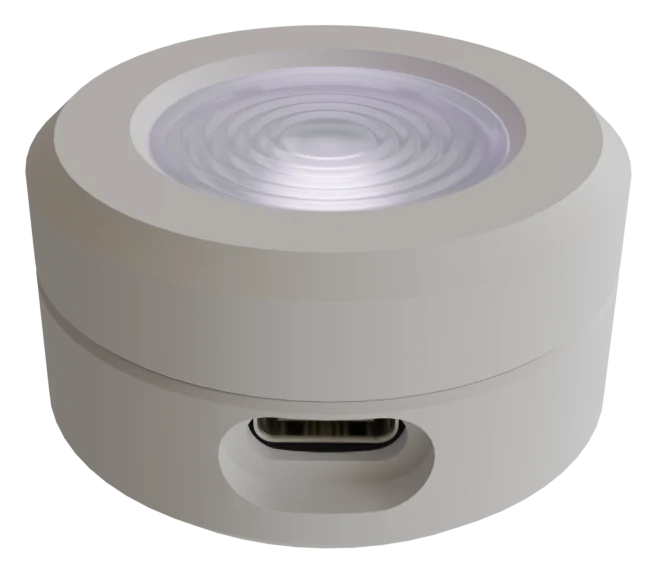
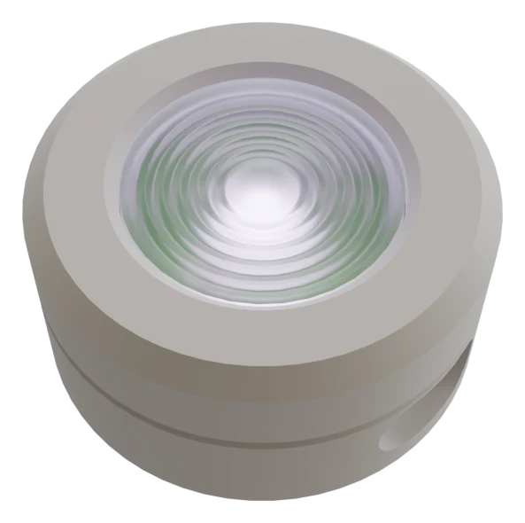
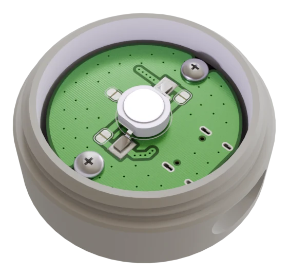
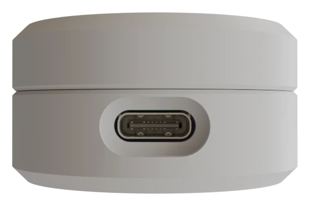
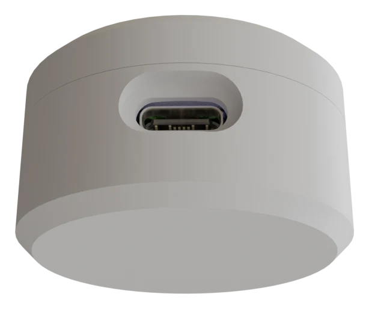
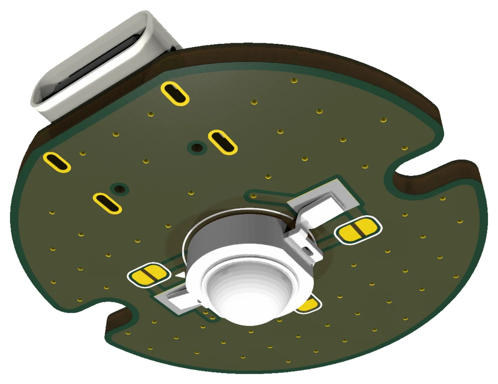
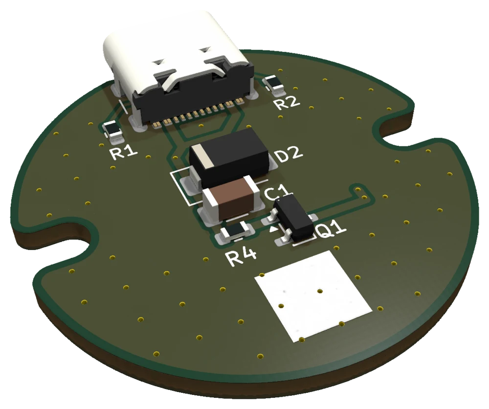

<div align="center">

# Soldermask UV Lamp

**A tiny, USB-C powered UV lamp for curing UV soldermask on home-made PCBs.**
Plug it into any USB-C charger, put it over the board and let the UV LED harden the mask.




[](LICENSE)

</div>

---

## Features

- **High-power UV LED.** Prolight Opto **PK2N-1KQE-SL** in a 1 W / 3 W package, with an optical lens on top to focus the light onto the board.
- **USB-C power.** 5.1 kΩ CC pull-downs, so it runs from any USB-C charger or power bank (C-to-C cables included). No buttons, no firmware – plug in and it's on.
- **Input protection.** TVS diode and a 10 µF bulk capacitor on VBUS.
- **Simple driver.** BC817 low-side transistor switch for the LED.
- **Configurable thermal pad.** Solder jumpers JP1–JP3 set how the LED's centre pad is connected (5 V / GND).
- **Built for heat.** Ø30 mm round PCB with an exposed copper pad and a dense via array to spread heat from the LED.
- **3D-printed enclosure.** Two parts screwed together by a thread, PCB held with two M2.5 screws.

## Gallery

<table>
  <tr>
    <td align="center" width="50%"><br><sub>Lens side</sub></td>
    <td align="center" width="50%"><br><sub>Inside, with the top part removed</sub></td>
  </tr>
  <tr>
    <td align="center"><br><sub>USB-C port</sub></td>
    <td align="center"><br><sub>Bottom</sub></td>
  </tr>
</table>

### PCB

<table>
  <tr>
    <td align="center" width="50%"><br><sub>LED side</sub></td>
    <td align="center" width="50%"><br><sub>USB-C and driver side</sub></td>
  </tr>
</table>

📄 **[Schematic (PDF)](docs/schematic.pdf)**

## Hardware overview

| Block | Part | Notes |
|---|---|---|
| UV LED | [Prolight Opto PK2N-1KQE-SL](https://www.tme.eu/pl/details/pk2n-1kqe-sl/diody-led-uv/prolight-opto/) | 1 W / 3 W package (`LED_1W_3W_R8` footprint) |
| Lens | [Citizen ILU-006-W](https://www.tme.eu/pl/details/ilu-006-w/soczewki/citizen-electronics/ilu-006-w-as/) | Focuses the beam onto the PCB |
| Driver | BC817 (SOT-23) | Low-side switch, 2.2 kΩ base resistor from VBUS |
| Power input | USB-C receptacle (GCT USB4105) | 5 V only, 2× 5.1 kΩ CC pull-downs |
| Protection | TVS diode (SMA) + 10 µF | On VBUS |
| PCB | Ø30 mm, round, 2 layers | Exposed copper + via array for cooling |

```
 USB-C (5 V) ──► TVS + 10 µF ──► UV LED (PK2N-1KQE-SL) ──► BC817 ──► GND
     │                                │                       ▲
     └── CC1/CC2: 5.1 kΩ to GND       └── JP1–JP3: LED pad    └── 2.2 kΩ from VBUS
```

## Repository structure

```
.
├── 01_Hardware/
│   ├── 01_KiCad/
│   │   ├── soldermask-uv-lamp/    # KiCad project (schematic + PCB)
│   │   │   └── production/        # Gerbers, BOM, pick & place
│   │   └── lib/                   # 3D models of the UV LED
│   └── 02_3D_Model/
│       ├── 3D-Printing/           # Enclosure STL files + print project (3MF)
│       └── model.blend            # Blender scene used for the renders
└── docs/                          # Images and schematic PDF for this README
```

## Roadmap

- [x] Schematic
- [x] PCB layout v0.1 (Ø30 mm)
- [x] Enclosure design & renders
- [ ] Order and assemble the first prototype
- [ ] Measure LED current and temperature
- [ ] Find the right exposure time for common UV soldermasks
- [ ] Hardware v1.0 release

## Building one

> [!WARNING]
> This project is **work in progress**. Hardware v0.1 has not been fully tested yet, so order boards at your own risk.

> [!CAUTION]
> **UV light can damage your eyes and skin.** Never look into the LED while it is on, and use UV-blocking glasses.

1. Open `01_Hardware/01_KiCad/soldermask-uv-lamp/soldermask-uv-lamp.kicad_pro` in **KiCad 10**.
2. The fabrication files (Gerbers, BOM, CPL) are in `production/`.
3. Set the solder jumpers JP1–JP3 according to the LED's datasheet (see the schematic).
4. Print the enclosure from `01_Hardware/02_3D_Model/3D-Printing/`, fit the lens, screw the PCB in with two M2.5 screws and screw the top part on.

## How to use

1. Apply UV-curable soldermask to the PCB and cover it with the printed mask / transparency.
2. Put the lamp over the board, lens down, and plug in USB-C.
3. Expose for a few minutes. The right time depends on the soldermask and the distance, so make a test strip first.
4. Remove the transparency, develop the mask and do a final cure.

## License

**Hardware** (schematics, PCB, enclosure, renders): [**CC BY-NC-SA 4.0**](LICENSE).
You may build, study and modify this design for **non-commercial** purposes, as long as you credit the author and share your changes under the same license.
**Selling boards, kits or devices based on this design is not allowed** without the author's written permission.

For commercial licensing, please get in touch.

---

<div align="center">
<sub>Designed by <b>Szymon Wąchała</b> · 2025–2026</sub>
</div>
